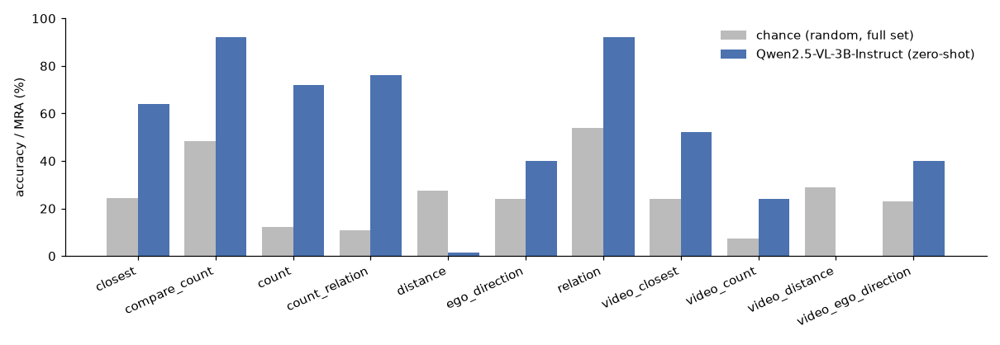

# Spatial-R1: Reinforcement Learning for 3D Counting and Relational Reasoning in VLMs

[](https://github.com/selfishout/spatial-r1-vlm/actions/workflows/tests.yml)


R1-style reinforcement learning with **verifiable rewards** (GRPO) to teach vision-language models to
*count* and *reason about spatial relations* among 3D objects in cluttered scenes, from a single image and from
multi-frame video.

Spatial questions are an ideal fit for RL with verifiable rewards. Every answer is checkable against exact 3D
ground truth from [spatial-scene-bench](https://github.com/selfishout/spatial-scene-bench), the data is unlimited
and procedurally generated, and question types can be balanced so the policy cannot exploit language priors.

```
 spatial-scene-bench  ─►  prompts + images / frames  ─►  Qwen2.5-VL policy  ─►  G completions per prompt
        (3D GT)                                                                    │
                                                                                   ▼
                         GRPO / Dr. GRPO / DAPO update  ◄──  group-relative advantages  ◄──  verifiable rewards
```

## What's inside

| Component | File | Notes |
| --- | --- | --- |
| Reward functions | `spatial_r1/rewards.py` | strict `<think>…</think><answer>…</answer>` format reward; exact match for yes/no and multiple choice; **VSI-Bench mean relative accuracy** for metric distances; exact counts with optional dense partial credit for near-misses; soft overlong-reasoning penalty |
| Data pipeline | `spatial_r1/data.py` | **scene-disjoint** train/val split, per-type balancing, uniform frame subsampling for video, conversational multi-image prompts |
| Trainer | `train_grpo.py` | TRL `GRPOTrainer`, LoRA via PEFT, any `GRPOConfig` field from YAML or the CLI |
| Configs | `configs/` | Qwen2.5-VL-3B LoRA with Dr. GRPO (images); Qwen2.5-VL-7B with DAPO clip-higher (video) |

Design choices follow recent R1-for-VLM work: no KL term (`beta: 0`) and unscaled, length-unbiased advantages
(Dr. GRPO), and asymmetric clipping for multi-frame inputs (DAPO). Count rewards use partial credit early on
because exact-match counting rewards are very sparse for 8–12 object scenes.

## Quick start

```bash
pip install -e ".[train]"            # also installs spatial-scene-bench

# 1) generate training data (exact 3D ground truth)
ssb-generate --out data/ssb --num-scenes 5000 --video-frames 16

# 2) train
accelerate launch train_grpo.py --config configs/qwen2_5_vl_3b_lora.yaml

# 3) evaluate the checkpoint on held-out scenes with the same parser used for rewards
ssb-generate --out data/ssb_test --num-scenes 300 --seed 999
ssb-eval --data data/ssb_test --model hf:outputs/spatial-r1-qwen2.5vl-3b-lora \
  --prompt-suffix "First think inside <think></think> tags, then answer inside <answer></answer> tags."
```

Smoke test on any machine (tiny random VLM, 2 optimizer steps):

```bash
python train_grpo.py --model_name_or_path trl-internal-testing/tiny-Qwen2_5_VLForConditionalGeneration \
  --data_dir data/ssb --modality image --output_dir /tmp/grpo_smoke --max_steps 2 \
  --per_device_train_batch_size 4 --num_generations 4 --max_completion_length 32 \
  --report_to none --use_cpu true --save_strategy no
```

This smoke test has been verified end to end: dataset casting, multi-image rollouts, all three reward functions
and the Dr. GRPO update. TRL ≥ 1.0 requires Triton for GRPO's fused log-prob kernel, so on macOS use
`trl==0.24` with `transformers==4.57`. On Linux GPUs, recent TRL releases work.

## Reward details

| Answer type | Reward | Example |
| --- | --- | --- |
| count | 1 if exact; otherwise `0.5 · MRA(pred, gt)` (dense) or 0 | gt 5: answer 5 gives 1.0, answer 4 gives 0.3 |
| yes / no | exact match | |
| multiple choice | exact letter match (also parses `(B) front-right`) | |
| metric distance | MRA averaged over thresholds 0.50…0.95 | VSI-Bench protocol |
| format | 1 iff the whole completion is `<think>…</think><answer>…</answer>` | |
| length | 0 within budget, down to −1 at 2× budget | discourages rambling chains |

The answer is extracted **only** from the `<answer>` span, so a correct number outside the required format
earns nothing.

## Baseline to beat

Zero-shot Qwen2.5-VL-3B-Instruct on spatial-scene-bench (25 questions per type; details in the
[benchmark README](https://github.com/selfishout/spatial-scene-bench#first-results)). Single-view counting and
relations are reasonable, but cross-frame counting, egocentric direction and metric distance are near or below
chance. Those are the targets for RL.



## Status and roadmap

- [x] Reward functions, data pipeline and trainer, with unit tests and a verified end-to-end GRPO smoke run
- [x] Image and multi-frame (video) prompts, LoRA, Dr. GRPO / DAPO objectives
- [ ] Qwen2.5-VL-3B image runs: zero-shot vs. GRPO on held-out scenes, per question type
- [ ] Video runs on orbit sequences (counting each physical object once across frames)
- [ ] Transfer to real benchmarks: VSI-Bench, CV-Bench (count / relation / depth / distance), SpatialScore
- [ ] Curriculum on scene complexity (number of objects, occlusion) and process rewards from scene-graph traces of
      [scene-graph-spatial-reasoner](https://github.com/selfishout/scene-graph-spatial-reasoner)
- [ ] Qwen3-VL and InternVL3 backbones

## Related work this builds on

[DeepSeek-R1](https://arxiv.org/abs/2501.12948) ·
[R1-V](https://github.com/StarsfieldAI/R1-V) ·
[VLM-R1](https://github.com/om-ai-lab/VLM-R1) ·
[Video-R1](https://github.com/tulerfeng/Video-R1) ·
[SpaceR](https://github.com/OuyangKun10/SpaceR) ·
[Spatial-MLLM](https://github.com/THU-SI/Spatial-MLLM) ·
[VSI-Bench / Thinking in Space](https://github.com/vision-x-nyu/thinking-in-space) ·
[EasyR1](https://github.com/hiyouga/EasyR1) ·
[TRL](https://github.com/huggingface/trl) ·
[Dr. GRPO](https://arxiv.org/abs/2503.20783) ·
[DAPO](https://arxiv.org/abs/2503.14476)

## License

MIT
